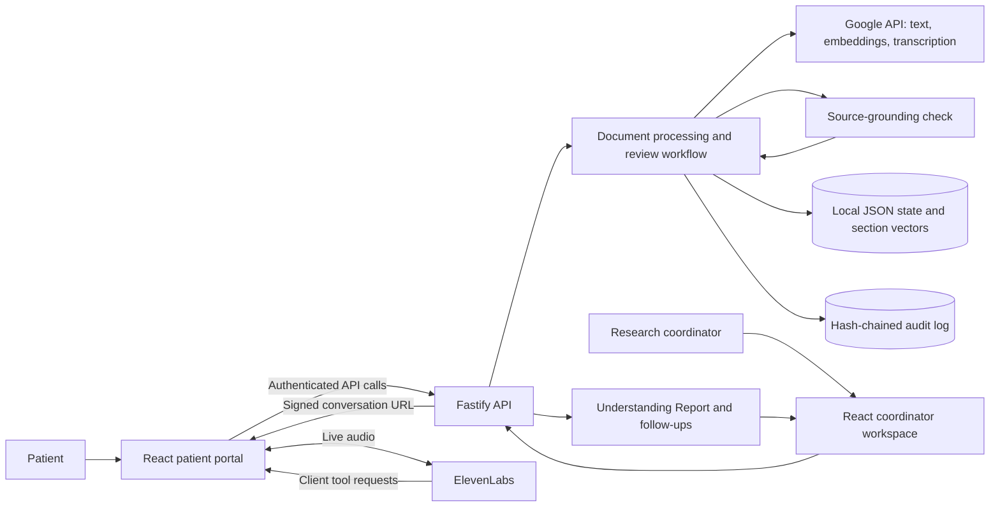

# SoundConsent

**The Teach-It-Back Consent Companion: help patients understand a clinical trial before the final consent discussion.**

SoundConsent turns an informed consent form (ICF) into a guided conversation. Patients review the form section by section through text, dictation, or live voice, then explain key points in their own words. Research coordinators receive an **Understanding Report** showing what was understood, where explanations need more work, and which questions require a clinician.

The project serves patients preparing at home or in a clinic, and the research nurses, coordinators, and investigators who support them. Its central workflow is **explain → check understanding → clarify → hand off**.

> **Status:** Working prototype for public or synthetic data. The assistant prepares patients for a human-led consent discussion. It does not give medical advice, persuade people to enroll, verify clinical identity, or obtain participation consent. Clinical effectiveness has not been established for this software.

## Why this matters

A signed form does not reveal which parts of a study someone understands. SoundConsent uses **teach-back**: asking people to explain information in their own words, then clarifying misunderstandings. AHRQ recommends this approach and provides consent-specific questions. Teach-back checks the quality of the explanation; it should not make the patient feel tested. [AHRQ, Health Literacy Universal Precautions Toolkit, Tool 5](https://www.ahrq.gov/health-literacy/improve/precautions/tool5.html).

### The evidence, in numbers

These published findings quantify the problem and support the method. **They are external research results, not measured outcomes from SoundConsent.**

| Evidence | Published finding | Relevance to SoundConsent |
| --- | --- | --- |
| Understanding clinical-trial consent | A 2015 meta-analysis of **103 studies and 135 participant cohorts** estimated that **52.1%** understood randomization, **67.0%** understood potential risks and side effects, and **75.8%** understood the freedom to withdraw. | Check these concepts explicitly and bring unresolved misunderstandings to the coordinator. [Tam et al., *Bulletin of the World Health Organization*](https://pmc.ncbi.nlm.nih.gov/articles/PMC4371493/). |
| Measured benefit of repeat-back | In a **575-patient randomized trial** of surgical consent, mean comprehension was **71.4% with repeat-back versus 68.2% without it**: a **3.2 percentage-point difference** (*P* = 0.03). The repeat-back discussion took **2.6 additional minutes**. | Supports an interactive comprehension check while showing that staff-time savings cannot be assumed. This was surgical consent, not an AI-assisted clinical-trial workflow. [Fink et al., *Annals of Surgery*, 2010](https://pubmed.ncbi.nlm.nih.gov/20562609/). |
| Broader evidence for interactive explanations | A 2020 review covering **52 studies and 60 interventions** found statistically significant comprehension improvements in **3 of 3** verbal test/feedback or teach-back interventions and **11 of 13** interactive digital interventions. | Supports evaluating a digital teach-back approach. These are counts of successful interventions, not patient success rates or effect sizes. [Glaser et al., *Medical Decision Making*](https://pubmed.ncbi.nlm.nih.gov/31948345/). |

The 2015 figures are historical pooled estimates from studies searched through October 2013, not a current prevalence estimate for every trial population. In the 2020 review, **23 of 52 studies had high risk of bias**, and variation between interventions prevented a pooled effect-size estimate. The Fink trial is also included in that review, so those two sources are not independent replications. [Tam et al.](https://pmc.ncbi.nlm.nih.gov/articles/PMC4371493/), [Glaser et al.](https://pubmed.ncbi.nlm.nih.gov/31948345/).


### The impact this project is designed to make

SoundConsent makes comprehension gaps visible before the final discussion, gives patients another opportunity to ask questions, and gives coordinators a section-specific follow-up record. Whether that improves understanding or reduces total staff time needs to be measured in a prospective evaluation.

| Outcome to evaluate | Suggested measurement |
| --- | --- |
| Better understanding | Compare independently scored comprehension after usual consent preparation versus preparation with SoundConsent; report percentage-point differences and confidence intervals. |
| Reliable AI assessments | Compare AI section assessments with blinded human reviewers, especially cases where the AI passes an answer a reviewer considers inadequate. |
| Useful human follow-up | Measure unresolved gaps before the final discussion and their resolution afterward. |
| Coordinator workload | Measure total staff minutes, including setup, report review, discussion, and follow-up. |
| Completion and safety | Track started/completed reviews, drop-off, unsupported answers, and escalation handling; examine differences by literacy, language, and modality. |

The repository does not establish a percentage improvement in comprehension, hours saved, recruitment gains, or a zero-hallucination rate.

## How it works

1. **Prepare the source.** A coordinator uploads an ICF PDF. The backend extracts its version, checks it against a configured study/version allow-list, and divides the text into sections. New reviews preserve a snapshot of the published content.
2. **Invite the patient.** Assign a review to an existing patient username, or create a first-time invitation with a private link and separate access code. Patients can sign back in to resume their assigned studies.
3. **Explain a section.** The assistant identifies itself as AI and presents a plain-language explanation, targeting a sixth- to eighth-grade reading level.
4. **Check understanding.** The patient asks questions or explains the section in their own words. Questions and ambiguous acknowledgments do not consume a teach-back attempt. By default, an unsuccessful attempt gets one re-explanation; a second unsuccessful attempt creates a follow-up flag and advances the review. Study settings allow one to three total attempts.
5. **Route unresolved questions.** Answers are generated from the consent text with a secondary grounding check. Unsupported or medical-advice questions are directed to the clinical team and recorded for follow-up.
6. **Review and hand off.** The coordinator reads the Understanding Report, reviews assessments and questions, and assigns or resolves follow-ups. The human investigator or authorized delegate conducts the final consent discussion.

For example, a patient might say, “I have to stay in the study once I join.” The assistant checks that statement against the form's withdrawal section, clarifies the source information, and asks again. If understanding remains unclear, the report preserves that gap for the coordinator.

**Finishing the review is not consent.** A participant may acknowledge review completion, but reports retain `consentObtained: false`; resolving a follow-up does not rewrite the original assessment.

## Current capabilities

| Area | Implemented behavior |
| --- | --- |
| Patient review | Responsive patient portal, section progress, resumable reviews, shared text/voice history, and completion acknowledgment. |
| Text and audio | Unified question/teach-back chat; microphone dictation into an editable draft; live ElevenLabs voice conversations with text fallback. |
| Document management | PDF uploads up to **20 MiB**, version validation, draft section editing, administrator publication, archiving, and immutable review snapshots. |
| Coordinator workspace | Document and review catalogs, Understanding Reports with JSON download, follow-up assignments, due dates, status, and history. |
| Access control | Separate staff and patient accounts, study-scoped staff access, HttpOnly authentication cookies, invitations, and access revocation. |
| Reliability | Persisted review state, idempotent mutations, and revision checks to prevent duplicate grading or advancing a stale answer. |
| Notifications | Built-in coordinator inbox and an optional institution-managed email/SMS relay; external delivery is disabled by default. |

## Architecture



- **Frontend:** React 19, TypeScript, Vite, React Router, TanStack Query, Tailwind CSS, and reusable UI components. Patient screens emphasize a calm, focused review; coordinator screens emphasize actionable information.
- **Backend:** TypeScript on Node.js 24+, Fastify, PDF extraction, document/version controls, session orchestration, reporting, and authentication.
- **AI:** Google-hosted text generation and assessment, Gemini embeddings for section retrieval, and Gemini audio transcription. Model selection is configurable in the backend; see [the environment template](backend/.env.example) for repository defaults.
- **Voice:** ElevenLabs browser SDK over WebSocket. Client tools execute through the signed-in browser and normal backend API. Browser voice does not need a public webhook tunnel; legacy server-to-server tools do.
- **Persistence:** Local JSON stores documents, vectors, accounts, reviews, and follow-ups. An append-only hash chain provides audit tamper evidence. Run **one backend process per data directory**.

## Run locally

### Prerequisites

- Node.js **24 or newer** and npm.
- A Google API key with access to the configured text, embedding, and transcription models. Real document ingestion and AI reviews call these services and may incur provider charges.
- Optional ElevenLabs credentials for live voice and speech generation. Text review does not require ElevenLabs.

### 1. Configure and start the backend

From the repository root:

```sh
cd backend
npm ci
cp .env.example .env
```

Edit `backend/.env` before starting:

| Setting | Local configuration |
| --- | --- |
| `GEMINI_API_KEY` | Your Google API key. |
| `BOOTSTRAP_COORDINATOR_EMAIL` | Email for the first administrator. |
| `BOOTSTRAP_COORDINATOR_PASSWORD` | A unique password of 12–256 characters. |
| `CORS_ORIGIN` | Keep `http://localhost:5173` for the default frontend. |
| `ELEVENLABS_API_KEY` | Optional; required when enabling voice. |
| `ELEVENLABS_VOICE_ID` | Optional voice override. |

Start the API from `backend/`:

```sh
npm run dev
```

The API defaults to `http://localhost:3001`. Bootstrap creates an administrator only when the account store is empty; remove both bootstrap values after the account has been created. There are no default login credentials.

### 2. Start the frontend

In a second terminal, from the repository root:

```sh
cd frontend
npm ci
npm run dev -- --port 5173 --strictPort
```

Open [the local app](http://localhost:5173) and sign in at `/login`. Vite forwards `/api` to the backend on port 3001; no frontend environment file is needed for this default setup. Keep provider keys and passwords on the backend, never in `VITE_*` variables.

### 3. Try a complete review

1. Under **Documents**, upload `sample_icfs/NCT01823991_ICF_001.pdf`, enter study ID `NCT01823991`, and use version `10` if supplying the optional version field. This matches the checked-in ingestion demo configuration.
2. Create a review from the uploaded document.
3. Use a separate browser profile for the patient, register at `/patient`, and share that username with the coordinator. Assign the review through **Invite to study**. Alternatively, create a first-time invitation and share its link and code separately; the app does not automatically send invitations.
4. Open the assigned study, complete the AI disclosure/overview, and start the review. Try a question, a correct teach-back answer, and an answer that needs clarification.
5. Return to the coordinator workspace and open **View Report** to inspect assessments and follow-ups.

The five PDFs in `sample_icfs/` are historical public consent documents from ClinicalTrials.gov. **Their inclusion and the local allow-list do not establish current IRB approval.** Other samples may require a matching demo entry in [approved-versions.json](backend/data/approved-versions.json); the uploaded PDF must contain a recognizable, matching version. Restart the backend after changing the allow-list.

To try live voice, configure ElevenLabs, restart the backend, and provision the agent under **Settings → Voice setup**. Then select **Voice mode** in the review composer. Microphone access needs localhost or HTTPS. Dictation uses Google transcription and lets the patient edit the draft before sending.

## Development checks

Run backend checks from `backend/`:

```sh
npm run typecheck
npm test
npm run build
```

Run frontend checks from `frontend/`:

```sh
npm run lint
npm test
npm run build
npx playwright install chromium
npm run test:e2e
```

The browser suite starts an isolated Fastify backend with temporary data and a deterministic AI provider. Backend dependencies must be installed first. These tests cover application workflows; live model quality, actual microphone/provider behavior, and real notification delivery need separate configured evaluations.

## Deployment and limitations

Both packages include Dockerfiles. See the [backend deployment guide](backend/README.md#deploy-with-docker) and [frontend deployment guide](frontend/README.md#docker-deployment) for image builds, persistent storage, HTTPS, and proxy configuration.

The prototype has material limits:

- **Clinical validation:** No clinical effectiveness study is included. A source-grounding evaluator reduces risk but cannot prove the PRD's zero-hallucination target. Human review remains essential.
- **Privacy and audit:** Pattern-based masking is not complete de-identification, and hash-chained logging is not immutable/WORM storage. Provider data flows, retention, and institutional privacy/security requirements need review before handling real patient data.
- **Approval and identity:** Version checks enforce a local allow-list, not a live IRB registry. Account or invitation possession is not clinical identity proofing. Completion acknowledgment is not an electronic consent signature.
- **Operations:** JSON persistence and in-process coordination require a single backend writer. Distributed storage, broader authentication hardening, and password recovery remain future work.
- **Voice and accessibility:** Live browser voice is integrated, but measured sub-800 ms latency, clinical language validation, and comprehensive manual accessibility validation are not established. Notification relay acceptance also does not establish clinician receipt or action.

## Repository guide

| Location | Purpose |
| --- | --- |
| [backend/](backend/) | API, AI workflow, access control, persistence, tests, and deployment instructions. |
| [frontend/](frontend/) | Patient portal, coordinator workspace, browser tests, and deployment instructions. |
| [sample_icfs/](sample_icfs/) | Five public historical consent PDFs for development. |
| [Product requirements](prd-teach-it-back.md) | Mission, personas, core workflow, guardrails, and intended success metrics. |
| [Project brief](site-sheet-05-teach-it-back.md) | Problem background, terminology, public data sources, and demo goals. |
| [Architecture](architecture-teach-it-back.md) | Architectural rationale and the original system diagram. |
| [Engineering backlog](backlog-teach-it-back.md) | Epics and acceptance criteria. |
| [Backend action items](action-items-backend.md) | Backend implementation tracking and outstanding validation work. |
| [ElevenLabs quickstart](elevenapi-quickstart.md) | Supporting provider reference material. |
| [Frontend design system](frontend/design-system.md) | Visual design direction. |
| [Frontend plan](frontend/front-end-implementation.md), [action items](frontend/action-items-frontend.md), and [audit](frontend/audit-report.md) | Planning and historical implementation-review context. |

Planning documents and the historical audit describe earlier stages and sometimes propose features outside the current product boundary, including consent signing. Use this README for the project overview and the package READMEs and source for current operational details.

## License

[MIT](LICENSE). The license covers the project code; consult the original sources for the public sample documents and cited research.
