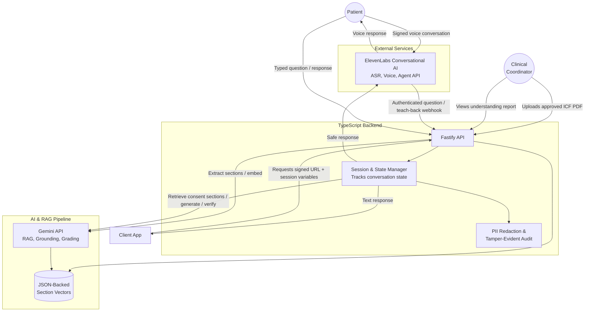

# High-Level System Architecture: Teach-It-Back

This document outlines the proposed system architecture developed in collaboration between Product Management and the Tech Lead. It prioritizes low-latency voice interactions and strict compliance boundaries.

## System Architecture Diagram

## Key Architectural Decisions (TL & PM Alignment)
1. **Voice MVP:** The backend provisions an authenticated ElevenLabs Conversational AI agent and signs session URLs. Its webhook tools route patient questions and teach-back responses through the existing Gemini-grounded backend. The frontend still needs to start the ElevenLabs conversation with the returned dynamic variables; no client implementation or end-to-end latency measurement is included.
2. **The "Guardrail Evaluator":** Before any LLM response is sent back to the patient, it passes through a secondary evaluation layer. If this layer detects external medical advice or facts not found in the Vector DB, it overwrites the response with the safe fallback ("Please ask your doctor").
3. **Compliance Logging:** Pattern-based redaction masks selected identifiers before Gemini calls and before storing session/audit events. The append-only hash chain is tamper-evident, not immutable or WORM storage, and pattern masking is not complete de-identification.
