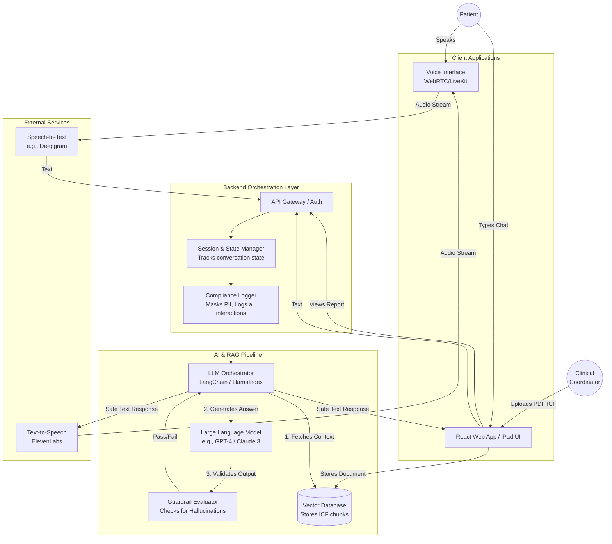

# High-Level System Architecture: Teach-It-Back

This document outlines the proposed system architecture developed in collaboration between Product Management and the Tech Lead. It prioritizes low-latency voice interactions and strict compliance boundaries.

## System Architecture Diagram

## Key Architectural Decisions (TL & PM Alignment)
1. **Low-Latency Voice (WebRTC):** We cannot use standard HTTP requests for voice. The architecture uses WebRTC (via frameworks like LiveKit or Pipecat) connecting directly to streaming STT (Speech-to-Text) and ElevenLabs TTS to keep latency under ~800ms.
2. **The "Guardrail Evaluator":** Before any LLM response is sent back to the patient, it passes through a secondary evaluation layer. If this layer detects external medical advice or facts not found in the Vector DB, it overwrites the response with the safe fallback ("Please ask your doctor").
3. **Compliance Logging:** A middleware layer strips potentially identifying information (PII) before sending text to external LLMs and logs an immutable transcript for the final Understanding Report.
